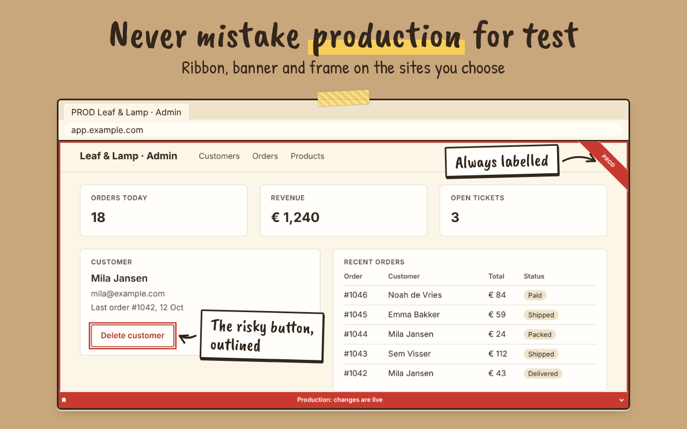

<p align="center">
  
</p>

<p align="center">
  <b>Never confuse production with test again.</b><br>
  A private, cross-browser extension that marks the websites you choose with ribbons, banners,
  outlines, stripes and more. It collects nothing and only runs on the sites you allow.<br>
  <a href="https://nielsbrakel.github.io/SiteMark/"><b>Website</b></a> ·
  <a href="https://nielsbrakel.github.io/SiteMark/privacy/">Privacy</a> ·
  <a href="https://nielsbrakel.github.io/SiteMark/support/">Support</a>
</p>

<p align="center">
  <a href="https://chrome.google.com/webstore/detail/kbpbafjebhbanajcefmkfhknbmgbndpg"></a>
  <a href="https://microsoftedge.microsoft.com/addons/detail/sitemark/edfcmbpeagdkacfidejninkikjiffojn"></a>
  <a href="https://addons.mozilla.org/en-US/firefox/addon/sitemark/"></a>
</p>

<p align="center">
  
</p>

<p align="center">
  <a href="https://github.com/nielsbrakel/SiteMark/actions/workflows/ci.yml"></a>
  <a href="LICENSE"></a>
  
</p>

<p align="center">
  <a href="https://github.com/nielsbrakel/SiteMark/actions/workflows/security.yml"></a>
  <a href="https://github.com/nielsbrakel/SiteMark/security/code-scanning"></a>
  <a href="docs/security-scanning.md"></a>
  <a href="https://github.com/nielsbrakel/SiteMark/actions/workflows/security.yml"></a>
  <a href="https://scorecard.dev/viewer/?uri=github.com/nielsbrakel/SiteMark"></a>
</p>

---

## Install

Add SiteMark from the [Chrome Web Store](https://chrome.google.com/webstore/detail/kbpbafjebhbanajcefmkfhknbmgbndpg),
[Edge Add-ons](https://microsoftedge.microsoft.com/addons/detail/sitemark/edfcmbpeagdkacfidejninkikjiffojn) or
[Firefox Add-ons](https://addons.mozilla.org/en-US/firefox/addon/sitemark/). Safari is coming in the future.
Try the marks in your browser first in the [playground](https://nielsbrakel.github.io/SiteMark/playground/).

## Why

Test, acceptance and production environments look the same. SiteMark lets you add
URL patterns (`https://*.example.com/*`) to a **site group** and puts a distinct marker on matching pages,
either on the whole page or on one element you pick (a logo, a header, that scary "Delete" button).

- 🎀 **Marks:** corner ribbons, banners, viewport frames, outlines, tints, hazard stripes,
  watermarks, `[PROD]` tab-title prefix and a favicon dot
- 🎯 **Picker:** hover and click any element, with an auto-generated stable CSS selector you can edit
- 🔒 **Private:** collects nothing, no accounts or analytics, [no install-time site access](#privacy). Your data
  stays in local storage; move it between devices with JSON import/export
- 🌗 **Scrapbook look:** paper sheets on a kraft board (a plum board in dark), handwriting type, popup and options page in light and dark, English and Dutch
- 🧭 **Everywhere:** Chrome, Edge and Firefox now, Safari coming in the future (Manifest V3)
- 🎨 **Colorblind-safe:** preset colors stay distinguishable, and marks always carry text

## Privacy

Privacy is a feature, and each claim is checked by a test (the requirement IDs are in [docs/spec.md](docs/spec.md#56-privacy--permissions--priv)):

- **Collects nothing:** no accounts, analytics, servers or crash reporting. Data lives in `storage.local`, never `storage.sync`.
- **Runs only where you allow:** no `host_permissions` and no static `content_scripts`. Access is requested for one
  website at a time, when you add its URL pattern, and you can revoke it. The only permissions are `storage`,
  `scripting` and `activeTab`.
- **No network requests of its own:** no remote code, fonts or CDNs, and the extension pages' CSP has `connect-src 'none'`.
  The one exception is the opt-in favicon tint, which loads the icon of the page you are on.
- **Source available:** the code is public to read and check, and the website is just as clean: no cookies, no third parties.

Read the full [privacy policy](PRIVACY.md) ([Nederlands](PRIVACY.nl.md)).

## Documentation

For users: the **[SiteMark website](https://nielsbrakel.github.io/SiteMark/)** explains the extension, and it
publishes the [privacy policy](PRIVACY.md) and the support routes.

| Doc                                                    | What                                                         |
| ------------------------------------------------------ | ------------------------------------------------------------ |
| [docs/spec.md](docs/spec.md)                           | Product specification with requirement IDs                   |
| [docs/plan.md](docs/plan.md)                           | Architecture, test strategy, milestones                      |
| [docs/tasks.md](docs/tasks.md)                         | TDD task list: the progress tracker                          |
| [docs/archive/tasks.md](docs/archive/tasks.md)         | The finished milestones M0–M6 of the task list               |
| [docs/design.md](docs/design.md)                       | Design system, screens, marker specs, logo                   |
| [docs/decisions.md](docs/decisions.md)                 | Decision log                                                 |
| [docs/testing.md](docs/testing.md)                     | How to test, the TDD protocol, manual smoke checklist        |
| [docs/conventions.md](docs/conventions.md)             | Code conventions and layering rules                          |
| [docs/repo-setup.md](docs/repo-setup.md)               | GitHub repository setup and store publishing                 |
| [docs/security-scanning.md](docs/security-scanning.md) | CodeQL, OWASP ZAP, Scorecard and gitleaks: what runs and why |
| [docs/release.md](docs/release.md)                     | Releasing: checklist, release notes template, rollback       |
| [docs/reviews/](docs/reviews/)                         | Specialist plan reviews and what happened to each finding    |
| [docs/website/](docs/website/spec.md)                  | The website: spec, plan, design and tasks                    |
| [store/listing.md](store/listing.md)                   | Store listing texts, URLs and images (version controlled)    |

## Contributing

Contributions are welcome! Read [CONTRIBUTING.md](CONTRIBUTING.md) for the workflow (strict TDD, rebase-merged
PRs) and follow the [Code of Conduct](CODE_OF_CONDUCT.md). Questions and help: [SUPPORT.md](.github/SUPPORT.md).

## Development

```bash
corepack enable && pnpm install   # needs Node 26 (see .nvmrc); older Node stops with ERR_PNPM_UNSUPPORTED_ENGINE
pnpm dev            # Chromium + HMR   (pnpm dev:firefox for Firefox)
pnpm test:watch     # unit/component tests (TDD loop)
pnpm test:e2e       # Playwright against the built extension
pnpm check          # everything CI checks except e2e
pnpm format         # Biome (code, JSON, CSS) + Prettier (Markdown, YAML)
pnpm progress       # progress + requirement traceability
pnpm web:dev        # the website (website/)
```

Stack: [WXT](https://wxt.dev) · React 19 · TypeScript · Vitest · Testing Library · Playwright · Biome · pnpm.

## Security

Please report vulnerabilities privately, as described in [SECURITY.md](SECURITY.md). It also documents the
threat model: SiteMark prevents _accidental_ confusion and is not a security control.

## License

All rights reserved, see [LICENSE](LICENSE). The code is public to read, not to copy or resell. Name and logo: [TRADEMARKS.md](TRADEMARKS.md).
