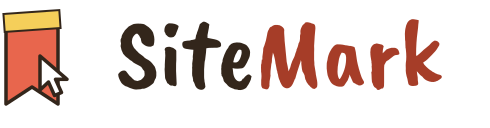
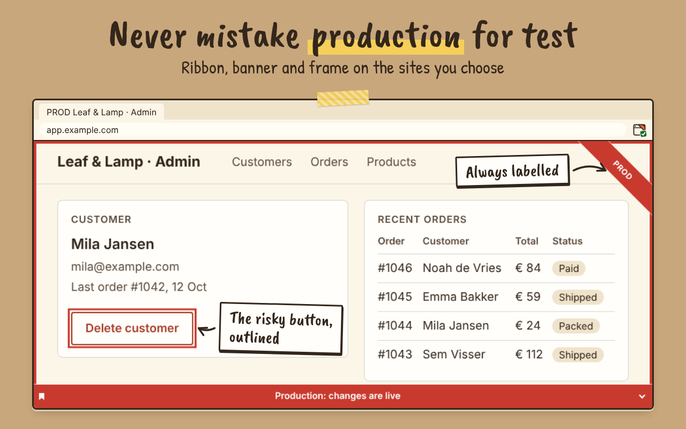

<p align="center">
  
</p>

<p align="center">
  <b>Never confuse production with test again.</b><br>
  A private browser extension that marks the websites you choose with ribbons, banners,
  outlines, stripes and more. It collects nothing and only runs on the sites you allow.<br>
  <a href="https://nielsbrakel.github.io/SiteMark/"><b>Website</b></a> ·
  <a href="https://nielsbrakel.github.io/SiteMark/privacy/">Privacy</a> ·
  <a href="https://nielsbrakel.github.io/SiteMark/support/">Support</a>
</p>

<p align="center">
  <a href="https://chrome.google.com/webstore/detail/kbpbafjebhbanajcefmkfhknbmgbndpg"></a>
  <a href="https://microsoftedge.microsoft.com/addons/detail/sitemark/edfcmbpeagdkacfidejninkikjiffojn"></a>
  <a href="https://addons.mozilla.org/en-US/firefox/addon/sitemark/"></a>
</p>

<p align="center">
  
</p>

<p align="center">
  <a href="https://github.com/nielsbrakel/SiteMark/actions/workflows/ci.yml"></a>
  <a href="LICENSE"></a>
  
</p>

<p align="center">
  <a href="https://github.com/nielsbrakel/SiteMark/actions/workflows/security.yml"></a>
  <a href="https://github.com/nielsbrakel/SiteMark/security/code-scanning"></a>
  <a href="docs/security-scanning.md"></a>
  <a href="https://github.com/nielsbrakel/SiteMark/actions/workflows/security.yml"></a>
  <a href="https://scorecard.dev/viewer/?uri=github.com/nielsbrakel/SiteMark"></a>
</p>

---

## Install

Add SiteMark from the [Chrome Web Store](https://chrome.google.com/webstore/detail/kbpbafjebhbanajcefmkfhknbmgbndpg),
[Edge Add-ons](https://microsoftedge.microsoft.com/addons/detail/sitemark/edfcmbpeagdkacfidejninkikjiffojn) or
[Firefox Add-ons](https://addons.mozilla.org/en-US/firefox/addon/sitemark/). Safari on the Mac is coming.
To see the marks first, try the [playground](https://nielsbrakel.github.io/SiteMark/playground/).

## Why

Test, acceptance and production environments look the same. In SiteMark you add URL patterns
(`https://*.example.com/*`) to a **site group**. Every matching page then gets a clear marker, on the whole
page or on one element you pick, such as a logo, a header or a scary "Delete" button.

- 🎀 **Marks:** corner ribbons, banners, frames, outlines, tints, hazard stripes, watermarks, a `[PROD]` tab-title
  prefix and a favicon dot
- 🎯 **Picker:** hover over any element and click it. SiteMark writes a stable CSS selector that you can edit
- 🔒 **Private:** no accounts, no analytics, no access to sites until you add one. Your data stays on your device.
  Move it between devices with JSON export and import
- 🌗 **Scrapbook look:** paper sheets on a kraft board (plum in dark mode), handwriting type, light and dark
  themes, English and Dutch
- 🧭 **Everywhere:** Chrome, Edge and Firefox today. Safari on the Mac is coming
- 🎨 **Colorblind-safe:** the preset colors stay easy to tell apart, and every mark carries text

## Privacy

Privacy is a feature, and a test checks each claim below.

- **Collects nothing.** No accounts, analytics, servers or crash reports. Data lives in `storage.local`, never in `storage.sync`.
- **Runs only where you allow it.** The manifest has no `host_permissions` and no static `content_scripts`. SiteMark
  asks for one website at a time, when you add its URL pattern, and you can revoke that. The only permissions are
  `storage`, `scripting` and `activeTab`.
- **Makes no network requests.** No remote code, fonts or CDNs, and the extension pages use `connect-src 'none'`.
  The one exception is the opt-in favicon tint, which reads the icon of the page you are on.
- **Open to read.** You can read and check the code. The website has no cookies and no third parties.

Read the [privacy policy](PRIVACY.md) ([Nederlands](PRIVACY.nl.md)).

## Documentation

Users: the [SiteMark website](https://nielsbrakel.github.io/SiteMark/) explains the extension, with the
[privacy policy](PRIVACY.md) and the support routes.

Contributors: start with [docs/tasks.md](docs/tasks.md), which lists what is next.

| Doc                                                    | What it covers                                            |
| ------------------------------------------------------ | --------------------------------------------------------- |
| [docs/spec.md](docs/spec.md)                           | What SiteMark does, as numbered requirements              |
| [docs/plan.md](docs/plan.md)                           | Architecture, test strategy, milestones                   |
| [docs/design.md](docs/design.md)                       | Design system, screens, marks, logo                       |
| [docs/decisions.md](docs/decisions.md)                 | Why we chose what we chose                                |
| [docs/testing.md](docs/testing.md)                     | How to test, the TDD protocol, the manual smoke checklist |
| [docs/conventions.md](docs/conventions.md)             | Code conventions and layering rules                       |
| [docs/repo-setup.md](docs/repo-setup.md)               | GitHub repository setup and store publishing              |
| [docs/security-scanning.md](docs/security-scanning.md) | The security scans: what runs and why                     |
| [docs/release.md](docs/release.md)                     | How to release, and what to do when it goes wrong         |
| [docs/website/](docs/website/spec.md)                  | The website: spec, plan, design and tasks                 |
| [store/](store/README.md)                              | Store listings and images, one folder per store           |

The finished tasks of milestones M0 to M6 are in [docs/archive/tasks.md](docs/archive/tasks.md).

## Contributing

Contributions are welcome. [CONTRIBUTING.md](CONTRIBUTING.md) explains the workflow: strict TDD and rebase-merged
pull requests. Please follow the [Code of Conduct](CODE_OF_CONDUCT.md). For questions, see [SUPPORT.md](.github/SUPPORT.md).

## Development

```bash
corepack enable && pnpm install   # needs Node 26 (see .nvmrc); older versions stop with ERR_PNPM_UNSUPPORTED_ENGINE
pnpm dev            # Chromium + HMR   (pnpm dev:firefox for Firefox)
pnpm test:watch     # unit/component tests (TDD loop)
pnpm test:e2e       # Playwright against the built extension
pnpm check          # everything CI checks except e2e
pnpm format         # Biome (code, JSON, CSS) and Prettier (Markdown, YAML)
pnpm progress       # task progress and requirement traceability
pnpm web:dev        # the website (website/)
```

Stack: [WXT](https://wxt.dev), React 19, TypeScript 7, Vitest 5, Testing Library, Playwright, Biome, pnpm.

## Security

Report vulnerabilities privately, as [SECURITY.md](SECURITY.md) describes. It also has the threat model:
SiteMark prevents _accidental_ mix-ups and is not a security control.

## License

All rights reserved. See [LICENSE](LICENSE). You can read the code, but not copy or resell it. For the name and logo, see [TRADEMARKS.md](TRADEMARKS.md).
